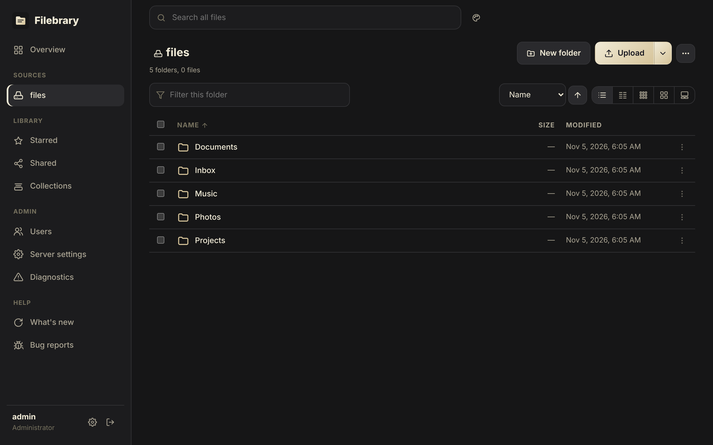

# Working with files

## Browsing

Each [source](../configuration/sources.md) you can view appears in the
sidebar. Open folders by clicking them; the path bar shows where you are
and each part of it is a link, and takes dropped items to move them there.
Sort by name, size or date.

Pick a view with the buttons above the list: details, compact, or small,
medium and large tiles with thumbnails. The choice is remembered per
account. Select with a click, Shift or Ctrl/Cmd and the keyboard (on a
phone, press and hold); the right-click menu (a sheet on phones) has every
command for the selection.

## Uploading

Drag files or whole folders onto the window, or use **Upload**. A panel
shows each upload with pause, retry and, when a file with the same name is
in the way, replace or keep both. Uploads are
split into chunks (at most [`max_chunk_mib`](../configuration/reference.md#max_chunk_mib)
each) and are **resumable**: if the connection drops, the upload carries on
from the last chunk instead of starting again. Unfinished uploads are kept
for [`upload_expiry_hours`](../configuration/reference.md#upload_expiry_hours)
and then removed. Folder structure is kept when you upload a folder.

You need the **upload** permission on the target folder.

## Downloading

Click a file to open or download it. Downloads support HTTP range requests,
so interrupted downloads can resume and video and audio can seek.

Select several files and folders and choose **Download** to get a single
zip file. It is built on the fly while it downloads, so it starts at once
and uses no disk space on the server.

## Rename, move, copy, delete

Use the context menu or the toolbar on a selection. Moving and copying work
within a source and between sources. You need **edit** to rename or move,
**upload** on the target to copy, and **delete** to delete.

## Trash, stars, tags and activity

Deleted items go to the trash and can be restored; it is emptied
automatically after [`trash_retention_days`](../configuration/reference.md#trash_retention_days).
**Star** items to bookmark them, **tag** them with any number of shared
tags, and see who did what in the **activity log**. All of this, with its
API, is on [Trash, tags, stars and activity](../organize.md).

## Comments

Select a file and choose **Comments** to read and add to its thread.
Anyone who can see the file can read the thread; posting needs
**download**. Authors can edit their own comments, and users with **edit**
on the file (and administrators) can delete any comment on it. Threads stay
attached when files are renamed, moved or trashed. API: `/api/comments`.

## Text editor

Text and code files open in a built-in editor when you click them, with
line wrapping and Ctrl/Cmd+S to save.

* Opening a file needs **download**; saving changes needs **edit**. Without
  **edit** the file opens read-only.
* Files up to 5 MiB that are UTF-8 text open in the editor. Larger or binary
  files are offered as a download instead.
* Saving never silently overwrites someone else's change. If the file was
  changed since you opened it (in another tab, by another user, through
  WebDAV or directly on disk), the editor says so and lets you load their
  version, overwrite it with yours, or keep editing.
* The editor warns you before you close it, or leave the page, with unsaved
  changes.
* Every save is recorded in the [activity log](../organize.md) as `edit`.

API: `GET /api/sources/{id}/text?path=...` returns
`{path, content, etag, size, modified}`. `PUT` on the same URL saves the raw
body and needs `If-Match: <etag>` from the load (or `If-None-Match: *` to
create a new file). A stale ETag gets `412 precondition_failed` with the
current `etag`; a save without either header gets `428`.

## Archives

Create a zip or tar.gz from a selection with **Create archive**; it runs as
a [job](jobs.md#archives) and the archive is saved in the folder you choose.

Open a zip (also `.jar`, `.cbz`), tar, tar.gz or 7z file to browse its
folders and download single files without extracting the whole archive.
Only the archive's index and the file you open are read, even on remote
sources. Browsing needs the **download** permission. Entries with unsafe
names (such as `../`) are hidden, and limits on entry count and size
([`jobs.max_archive_entries`](../configuration/reference.md#jobsmax_archive_entries),
[`jobs.max_archive_entry_mib`](../configuration/reference.md#jobsmax_archive_entry_mib))
protect the server from hostile archives. Files from inside an archive are
always downloaded, never displayed in the page.

API: `GET /api/sources/{id}/archive?path=/a.zip&dir=docs` lists a folder
inside the archive (leave out `dir` for every entry);
`GET /api/sources/{id}/archive/entry?path=/a.zip&entry=docs/readme.txt`
downloads one file.
