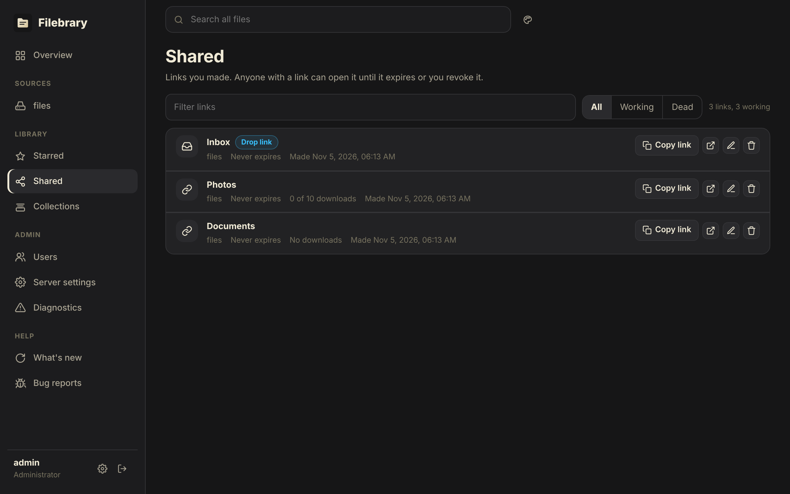
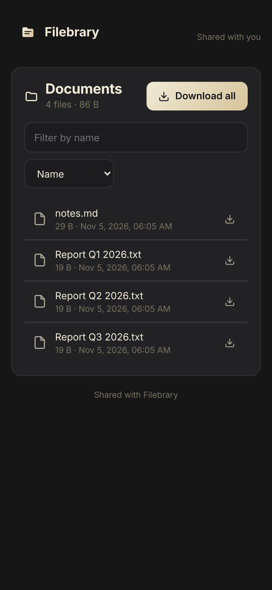

# Sharing

Anyone with the [**share** permission](../configuration/users.md#permissions) can create a link to a file or folder
they can download. The person receiving the link needs no account.

Share links are built from [`public_url`](../configuration/reference.md#public_url),
so set it when Filebrary is behind a proxy, or the links will point at the
wrong address.

## Options

| Option | Effect |
|---|---|
| **Password** | Visitors must enter it before seeing anything. It is stored hashed. |
| **Expiry date** | The link stops working after this date and time. |
| **Download limit** | The link stops working after this many downloads. |
| **Upload only (drop link)** | Visitors can upload into the folder but cannot see or download what is in it. Each file is limited to [`max_drop_upload_mib`](../configuration/reference.md#max_drop_upload_mib). |

A link never gives more access than its creator has. If the creator loses
access to the item, or their account is disabled or deleted, the link stops
working.

## Managing links

**Shared** in the sidebar lists your links, with their options and how many
times each was opened. You can copy, open, change or revoke a link at any
time; revoking takes effect immediately. **Dead** lists links that expired
or used up their download limit, and removes them in one go. Administrators
can see and remove every link.

## What visitors see

A link opens a page that needs no account: a password prompt first if the
link has one, then the file, or the folder to browse with a filter and
sorting, previews of pictures, video, sound and text, and **Download all**
as one zip. A drop link shows a box to drop files into, with progress per
file; uploads are sent in chunks and carry on after a dropped connection or
a reload. A link that expired answers like an unknown one; a link that used
up its download limit says so.

## Collections

A collection groups files and folders from any source, so you can share
them with one link. Select items and choose **Add to collection**; the
**Collections** page lists your collections and creates a share link for a
whole collection, with the usual password, expiry and download limit. The
link only serves items its owner may still share. API: `/api/collections`.

A collection link always shows the collection as it is now: items you add
later appear in it, items you remove disappear, and an item drops out of the
link as soon as you lose the **share** or **download** right on it. Items with
the same name get a ` (2)`, ` (3)`… suffix in the link. Downloading the whole
link gives one zip with every item, even when they come from different
sources. Collection links cannot be upload-only drop links, and deleting the
collection deletes its links.

To create one through the API, send `POST /api/shares` with
`{"collection_id": 7}` (plus the usual `password`, `expires_at` and
`max_downloads`) instead of `source` and `paths`.
