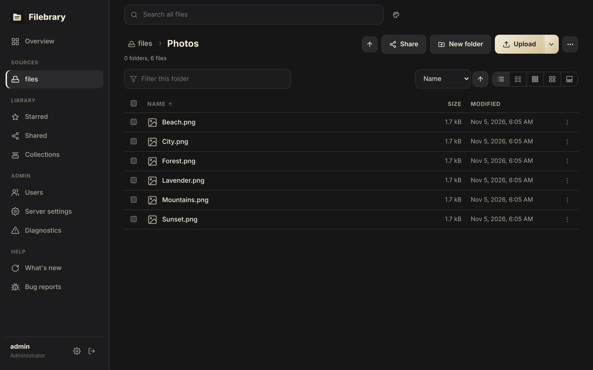
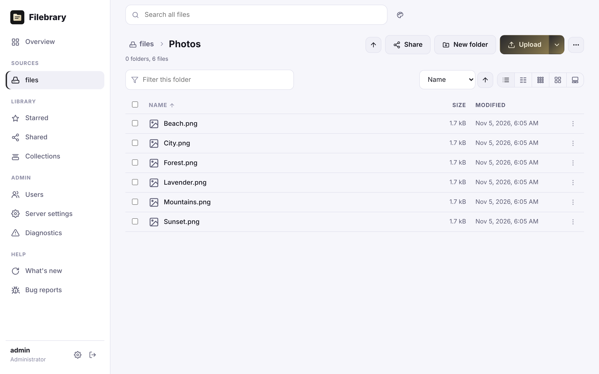

# Themes and branding

## Themes

Under **Settings → Appearance**, each user picks one of the kit's themes,
and the theme button in the top bar steps through them:

* **Encore** (the default): charcoal panels, cream text and a cream accent,
  from [Encore](https://github.com/Krifmaz/encore).
* **Dark**: a neutral dark theme.
* **Black (OLED)**: true black, for OLED screens.
* **Light**: light neutrals with a charcoal accent.
* **Follow the device**: light or dark, as the operating system is set.

The choice is kept in the browser, so it applies before signing in too.
Every page takes its colours from the kit's design tokens, so each theme
draws the whole app the same way.

## Branding

Administrators set, for the whole server, under **Admin → Branding**:

* the product name shown in the UI and the browser tab,
* the logo,
* the default theme for new users and visitors.

Branding also applies to the login page, share pages and the installed
[app](pwa.md). It is stored in the database, not in the configuration file,
so it is changed from the web UI and kept in [backups](../operations.md) of
the data directory.

The colour palettes earlier versions let administrators and users set are no
longer used: the kit's themes draw the colours. Stored palettes are ignored
and dropped the next time branding is saved.
