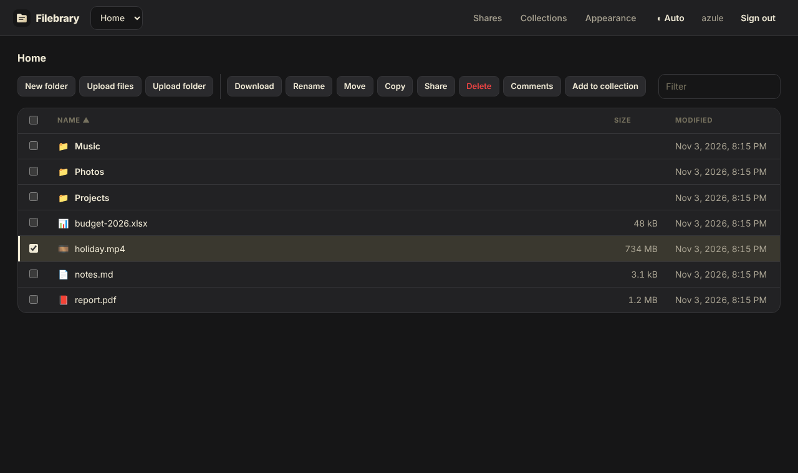

# Themes and branding

## Themes

Under **Appearance**, each user picks a theme: light, dark, follow the
system, or a custom palette of their own.

The built-in themes share the look of [Encore](https://github.com/Krifmaz/encore):

* **Dark** uses Encore's charcoal and cream: charcoal panels, cream text
  and a cream accent.
* **Light** uses Encore's light neutrals with a charcoal accent.

Both use the Inter typeface when it is installed (falling back to the
system font), rounded panels and pill-shaped tabs and badges. A custom
palette that leaves a colour unset takes it from the light theme, or from
the dark theme when its background is dark.

## Branding

Administrators set, for the whole server:

* the product name shown in the UI and the browser tab,
* the logo,
* the default theme for new users and visitors,
* the colours of each theme.

Branding also applies to the login page, share pages and the installed
[app](pwa.md). It is stored in the database, not in the configuration file,
so it is changed from the web UI and kept in [backups](../operations.md) of
the data directory.
